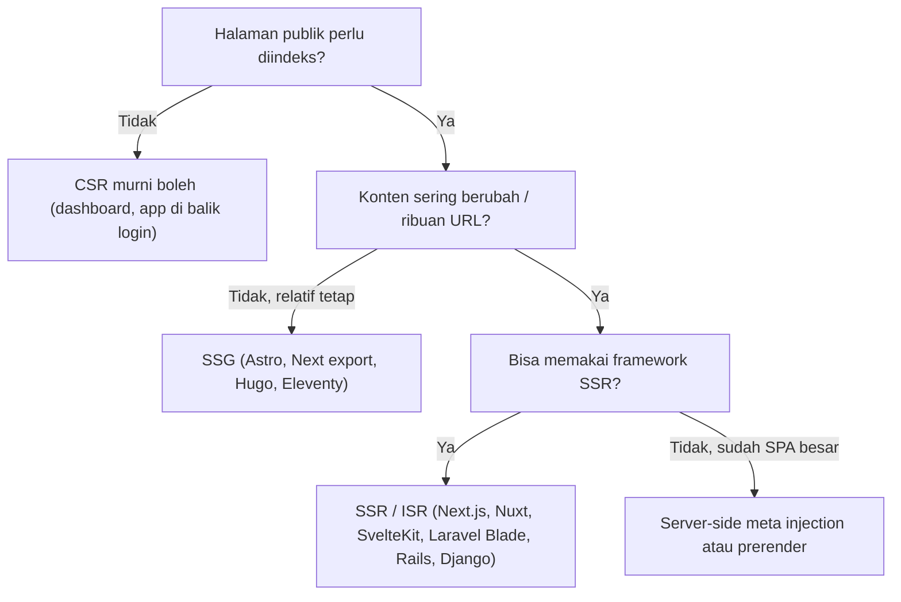
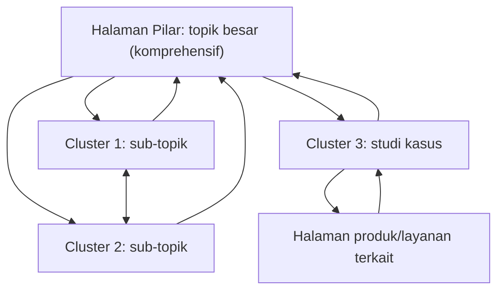
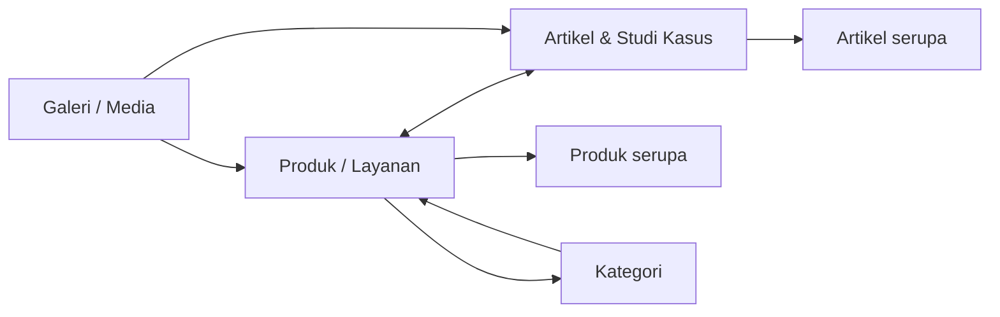

# Panduan Universal SEO, AEO & GEO untuk Semua Project Website

> **Versi**: 1.0 — November 2026
> **Sumber awal**: Audit implementasi SEO/AEO/GEO pada project CV Ateka Tehnik (React SPA + PHP + MySQL), yang kemudian digeneralisasi agar berlaku untuk **semua jenis website dan semua tech stack**.
> **Cara baca**: Dokumen ini bukan laporan audit satu situs. Ini adalah **playbook** yang bisa Anda salin ke repositori project baru, lalu dicentang satu per satu.

---

## Daftar Isi

0. [Cara Menggunakan Panduan Ini](#0-cara-menggunakan-panduan-ini)
1. [Konsep Dasar: SEO vs AEO vs GEO](#1-konsep-dasar-seo-vs-aeo-vs-geo)
2. [Keputusan Arsitektur Rendering (Fondasi Paling Penting)](#2-keputusan-arsitektur-rendering-fondasi-paling-penting)
3. [Technical SEO: Server, URL, Status Code, Robots & Sitemap](#3-technical-seo-server-url-status-code-robots--sitemap)
4. [On-Page SEO: Title, Meta, Heading, Gambar, HTML Semantik](#4-on-page-seo-title-meta-heading-gambar-html-semantik)
5. [Structured Data (Schema.org JSON-LD)](#5-structured-data-schemaorg-json-ld)
6. [Strategi Konten, Search Intent & Arsitektur Informasi](#6-strategi-konten-search-intent--arsitektur-informasi)
7. [Internal Linking & Distribusi Link Equity](#7-internal-linking--distribusi-link-equity)
8. [AEO: Answer Engine Optimization](#8-aeo-answer-engine-optimization)
9. [GEO: Generative Engine Optimization](#9-geo-generative-engine-optimization)
10. [Situs Multibahasa & Multiregion (hreflang)](#10-situs-multibahasa--multiregion-hreflang)
11. [Local SEO, Brand Protection & Sinyal E-E-A-T](#11-local-seo-brand-protection--sinyal-e-e-a-t)
12. [Performa & Core Web Vitals](#12-performa--core-web-vitals)
13. [Analytics, Pengukuran & Pelacakan Konversi](#13-analytics-pengukuran--pelacakan-konversi)
14. [Konten Berbantuan AI: Aturan Main yang Aman](#14-konten-berbantuan-ai-aturan-main-yang-aman)
15. [Katalog Kesalahan Umum (Pelajaran dari Audit)](#15-katalog-kesalahan-umum-pelajaran-dari-audit)
16. [Checklist Siap Pakai](#16-checklist-siap-pakai)
17. [Panduan per Tech Stack](#17-panduan-per-tech-stack)
18. [Roadmap Implementasi 30-60-90 Hari](#18-roadmap-implementasi-30-60-90-hari)
19. [Lampiran: Template Siap Salin](#19-lampiran-template-siap-salin)

---

## 0. Cara Menggunakan Panduan Ini

### 0.1. Konvensi Placeholder

Seluruh contoh kode memakai placeholder berikut. Ganti sebelum dipakai.

| Placeholder | Arti | Contoh |
| :--- | :--- | :--- |
| `{{DOMAIN}}` | Domain kanonis (satu versi saja) | `https://contoh.com` |
| `{{BRAND}}` | Nama brand/entitas, ejaan baku | `Contoh Studio` |
| `{{LEGAL_NAME}}` | Nama badan hukum | `PT Contoh Studio Indonesia` |
| `{{TAGLINE}}` | Deskripsi singkat bisnis | `Jasa desain interior di Bandung` |
| `{{LOGO_URL}}` | URL logo absolut | `https://contoh.com/logo.png` |
| `{{OG_DEFAULT}}` | Gambar OG default (1200×630) | `https://contoh.com/og-default.jpg` |

### 0.2. Pilih Profil Project Anda

Tidak semua bagian relevan untuk semua situs. Gunakan matriks ini untuk menentukan prioritas.

| Bagian | Company Profile / Jasa | E-commerce / Katalog | Blog / Media | SaaS / Aplikasi | Bisnis Lokal |
| :--- | :---: | :---: | :---: | :---: | :---: |
| Bab 2 Arsitektur rendering | ✅ | ✅✅ | ✅✅ | ✅ | ✅ |
| Bab 3 Technical SEO | ✅✅ | ✅✅ | ✅✅ | ✅✅ | ✅✅ |
| Bab 5 Schema `Product`/`Offer` | – | ✅✅ | – | ✅ (`SoftwareApplication`) | ✅ |
| Bab 5 Schema `Article` | ✅ | ✅ | ✅✅ | ✅ | ✅ |
| Bab 5 Schema `LocalBusiness` | ✅ | – | – | – | ✅✅ |
| Bab 6–7 Konten & internal link | ✅ | ✅✅ | ✅✅ | ✅ | ✅ |
| Bab 8 AEO (FAQ, jawaban langsung) | ✅✅ | ✅ | ✅✅ | ✅✅ | ✅✅ |
| Bab 9 GEO | ✅✅ | ✅ | ✅✅ | ✅✅ | ✅ |
| Bab 10 Multibahasa | Jika perlu | Jika perlu | Jika perlu | Jika perlu | Jarang |
| Bab 11 Local SEO | ✅ | – | – | – | ✅✅ |
| Bab 12 Core Web Vitals | ✅ | ✅✅ | ✅✅ | ✅ | ✅ |

✅✅ = prioritas tinggi · ✅ = relevan · – = opsional

### 0.3. Tiga Lapisan Prioritas

Jika waktu terbatas, kerjakan berurutan:

1. **Lapisan 1 — Bisa ditemukan & diindeks**: rendering, status code, robots, sitemap, canonical, HTTPS.
2. **Lapisan 2 — Bisa dipahami**: title, heading, structured data, konten sesuai intent, internal linking.
3. **Lapisan 3 — Bisa dikutip & dipercaya**: AEO, GEO, E-E-A-T, brand/entity consistency, ulasan, kanal resmi.

Lapisan 3 tidak ada gunanya jika Lapisan 1 gagal. Mesin AI tidak bisa mengutip halaman yang tidak bisa dibaca crawlernya.

---

## 1. Konsep Dasar: SEO vs AEO vs GEO

| | **SEO** | **AEO** | **GEO** |
| :--- | :--- | :--- | :--- |
| Kepanjangan | Search Engine Optimization | Answer Engine Optimization | Generative Engine Optimization |
| Tujuan | Peringkat tinggi di daftar hasil pencarian | Menjadi **jawaban langsung** (featured snippet, People Also Ask, voice, AI Overviews) | Menjadi **sumber yang dikutip/disebut** oleh ChatGPT, Perplexity, Gemini, Claude, Copilot |
| Unit keberhasilan | Posisi, klik, trafik organik | Tampil sebagai snippet/jawaban | Disebut, dikutip, atau direkomendasikan dalam jawaban AI |
| Sinyal utama | Relevansi, otoritas, pengalaman halaman | Struktur Q&A, jawaban ringkas, schema | Kejelasan entitas, fakta yang bisa diverifikasi, struktur yang mudah diekstrak, reputasi |
| Cara ukur | Google Search Console, rank tracker | GSC (query berbentuk pertanyaan), uji manual | Uji prompt manual berkala, referral dari domain AI, log server |

### 1.1. Prinsip yang Berlaku untuk Ketiganya

1. **Satu entitas, satu nama, satu fakta.** Nama brand, alamat, kontak, dan klaim harus identik di semua tempat.
2. **Konten yang bisa dibaca tanpa JavaScript.** Googlebot merender JS, tetapi banyak crawler lain (sosial media, sebagian crawler AI) tidak.
3. **Struktur mendahului gaya.** Heading, tabel, daftar, dan schema lebih penting daripada gaya penulisan.
4. **Jujur dan bisa diverifikasi.** Data buatan (rating palsu, harga asal) merusak ketiganya sekaligus.
5. **Ukur sebelum dan sesudah.** Setiap perubahan besar harus punya metrik pembanding.

### 1.2. Catatan Realistis tentang GEO

GEO masih bidang yang bergerak cepat. Beberapa teknik (misalnya `llms.txt` dan `ai.txt`) **belum menjadi standar yang terbukti dibaca oleh semua penyedia AI**. Perlakukan sebagai *investasi berbiaya rendah dan berpotensi positif*, bukan jaminan. Fondasi yang pasti berdampak adalah konten bermutu, struktur jelas, reputasi, dan crawler yang diizinkan masuk. Lihat [Bab 9](#9-geo-generative-engine-optimization).

---

## 2. Keputusan Arsitektur Rendering (Fondasi Paling Penting)

Pertanyaan pertama untuk setiap project: **"Apa yang diterima crawler saat meminta URL ini tanpa menjalankan JavaScript?"**

Uji cepat:

```bash
curl -s -A "Mozilla/5.0 (compatible; Googlebot/2.1)" https://{{DOMAIN}}/halaman-penting | head -100
```

Jika hasilnya hanya `<div id="root"></div>` dan tidak ada `<title>`, `<h1>`, maupun teks konten spesifik halaman, situs Anda **tidak aman untuk SEO/GEO** dan perlu salah satu strategi di bawah.

### 2.1. Pilihan Strategi

| Strategi | Cara Kerja | Cocok Untuk | Kelebihan | Kekurangan |
| :--- | :--- | :--- | :--- | :--- |
| **SSG** (Static Site Generation) | HTML dibuat saat build | Blog, company profile, dokumentasi | Tercepat, paling aman, murah | Rebuild saat konten berubah |
| **SSR** (Server-Side Rendering) | HTML dibuat per request | E-commerce, konten sering berubah | Selalu segar, SEO penuh | Butuh server, perlu caching |
| **ISR / Hybrid** | Statis + regenerasi berkala | Katalog besar, media | Seimbang | Konfigurasi lebih rumit |
| **Prerender** (build-time untuk SPA) | SPA dirender ke HTML saat build | SPA dengan rute terbatas | Perubahan minimal pada SPA | Tidak cocok untuk ribuan rute dinamis |
| **Server-side meta injection + SPA** | Server menyuntik meta/JSON-LD/konten ke template HTML sebelum dikirim | SPA lama yang sulit dimigrasi | Perubahan kecil, hasil bagus | Harus dijaga manual, risiko duplikasi logika |
| **Dynamic rendering** (render khusus bot) | Bot dapat versi berbeda | **Hindari** untuk project baru | – | Dianggap solusi sementara oleh Google, rawan *cloaking* jika isi berbeda |
| **CSR murni** | Semua di browser | Dashboard/admin/aplikasi di balik login | Sederhana | **Jangan** untuk halaman publik yang ingin diindeks |

### 2.2. Pohon Keputusan



### 2.3. Pola "Server-Side Meta Injection" untuk SPA (Referensi Implementasi)

Pola ini terbukti bekerja pada project sumber. Ide dasarnya: **semua request halaman publik melewati satu skrip server** yang memodifikasi `index.html` sebelum dikirim.

```text
Request → Web server (rewrite semua rute non-file ke skrip)
        → Skrip: tentukan jenis halaman dari URL
        → Ambil data dari DB/API (judul, deskripsi, gambar, konten)
        → Suntikkan ke template HTML:
             <title>, <meta description>, canonical,
             Open Graph, Twitter Card, JSON-LD,
             dan konten teks utama
        → Kirim HTML ke klien
        → SPA melakukan hydration dan mengambil alih navigasi
```

Contoh kerangka PHP (disederhanakan):

```php
<?php
$path = parse_url($_SERVER['REQUEST_URI'], PHP_URL_PATH);
$html = file_get_contents(__DIR__ . '/index.html');

$meta = [
  'title' => '{{BRAND}} | {{TAGLINE}}',
  'description' => 'Deskripsi default maksimal 160 karakter.',
  'image' => '{{OG_DEFAULT}}',
  'status' => 200,
];

if (preg_match('#^/produk/([^/?]+)#', $path, $m)) {
    $row = findProductBySlug($m[1]);          // query parameterized!
    if (!$row) { $meta['status'] = 404; }     // WAJIB: status 404 sungguhan
    else {
        $meta['title'] = "{$row['nama']} | {{BRAND}}";
        $meta['description'] = mb_substr(strip_tags($row['deskripsi']), 0, 160);
        $meta['image'] = absoluteUrl($row['gambar']);
    }
}

http_response_code($meta['status']);
$canonical = '{{DOMAIN}}' . $path;           // tanpa query string

$e = fn($s) => htmlspecialchars($s, ENT_QUOTES, 'UTF-8');   // selalu escape
$html = preg_replace('#<title>.*?</title>#s', '<title>' . $e($meta['title']) . '</title>', $html);
// ... ganti meta description, og:*, twitter:*, sisipkan canonical + JSON-LD
echo $html;
```

**Aturan penting pada pola ini:**

1. **Escape semua output** (`htmlspecialchars`) dan **gunakan query terparameter**. Data dari URL tidak boleh masuk ke HTML/SQL mentah.
2. **Kembalikan status 404 sungguhan** untuk slug yang tidak ada. SPA yang selalu menjawab `200` menghasilkan *soft 404*.
3. **Isi konten utama sebagai HTML nyata**, bukan hanya di `<noscript>`. Bagian `<noscript>` adalah *fallback* yang sah, tetapi lebih baik bila teks utama halaman memang ada di dalam `<body>` yang dikirim server (misalnya di dalam `#root` yang kemudian di-*hydrate*), supaya crawler dan pengguna melihat konten yang sama.
4. **Cache hasilnya** (file cache/CDN) agar skrip tidak membebani database pada setiap hit bot.
5. **Cakup juga halaman statis.** Jangan biarkan `/about`, `/faq`, `/contact` memakai deskripsi default beranda.

### 2.4. Aturan untuk SPA yang Tetap Berjalan di Klien

- Perbarui `document.title`, `canonical`, dan `lang` pada setiap perpindahan rute.
- Kirim *pageview* manual ke analytics pada setiap perpindahan rute (SPA tidak memuat ulang halaman).
- Jangan menyembunyikan konten penting di balik interaksi (tab yang baru dimuat saat diklik, *infinite scroll* tanpa URL paginasi).
- Pastikan tautan memakai `<a href>` sungguhan, bukan `onClick` pada `<div>`.

---

## 3. Technical SEO: Server, URL, Status Code, Robots & Sitemap

### 3.1. Satu Versi Domain Saja

Pilih **satu** bentuk kanonis lalu paksa lewat redirect 301:

- Protokol: selalu `https://`
- Host: `www` atau non-`www` (pilih salah satu)
- Trailing slash: konsisten (selalu ada atau selalu tidak)
- Huruf: URL selalu huruf kecil

**Apache (`.htaccess`)**

```apache
RewriteEngine On

# Paksa HTTPS
RewriteCond %{HTTPS} off
RewriteRule ^ https://%{HTTP_HOST}%{REQUEST_URI} [L,R=301]

# Paksa non-www (ganti sesuai pilihan)
RewriteCond %{HTTP_HOST} ^www\.(.+)$ [NC]
RewriteRule ^ https://%1%{REQUEST_URI} [L,R=301]
```

**Nginx**

```nginx
server {
  listen 80;
  server_name contoh.com www.contoh.com;
  return 301 https://contoh.com$request_uri;
}
server {
  listen 443 ssl http2;
  server_name www.contoh.com;
  return 301 https://contoh.com$request_uri;
}
```

### 3.2. Desain URL

| Praktik baik | Contoh | Hindari |
| :--- | :--- | :--- |
| Deskriptif, huruf kecil, tanda hubung | `/produk/mesin-pengering-gabah` | `/p?id=123`, `/Produk_Baru` |
| Stabil (tidak berubah-ubah) | `/blog/panduan-seo` | URL memuat tanggal jika konten evergreen |
| Hierarki mencerminkan struktur | `/layanan/desain-interior` | Kedalaman >4 level |
| Pemisahan berdasarkan intent | `/produk/`, `/studi-kasus/`, `/blog/` | Semua konten dicampur di satu path |
| Slug otomatis unik | `nama-produk`, `nama-produk-2` | Slug bentrok memicu error/duplikasi |

**Generator slug yang aman** (pseudocode):

```text
slug = lowercase(text)
slug = hapus karakter selain [a-z0-9 spasi -]
slug = ganti spasi/underscore berulang dengan '-'
slug = trim '-'
jika slug sudah ada di DB (selain record ini): tambahkan -2, -3, dst
```

**Saat mengganti URL**: buat redirect 301 dari URL lama ke URL baru dan pertahankan rute lama (*legacy route*) selama backlink masih ada.

### 3.3. Status Code yang Benar

| Kondisi | Status | Catatan |
| :--- | :--- | :--- |
| Halaman normal | `200` | |
| Dipindahkan permanen | `301` | Satu lompatan saja, hindari rantai redirect |
| Dipindahkan sementara | `302/307` | Jarang diperlukan |
| Halaman tidak ada | `404` | **Wajib status asli**, bukan `200` dengan teks "tidak ditemukan" |
| Dihapus permanen | `410` | Lebih cepat dilepas dari indeks |
| Error server | `500/503` | Sertakan `Retry-After` untuk pemeliharaan |

Halaman 404 yang baik: ada tautan ke beranda, pencarian, dan kategori utama (menurunkan *bounce*) serta kontak bantuan.

### 3.4. `robots.txt`

Fungsi: mengatur **crawling**, bukan menjamin sebuah halaman tidak terindeks. Untuk mencegah indeks gunakan `noindex` (dan jangan blokir halaman itu di robots agar `noindex` bisa terbaca).

```text
User-agent: *
Allow: /

# Blokir area privat
Disallow: /admin/
Disallow: /dashboard/
Disallow: /api/private/
Disallow: /cart
Disallow: /checkout
Disallow: /search?        # hasil pencarian internal (ruang tak terbatas)

# PENTING untuk situs berbasis JavaScript:
# izinkan API publik dan aset yang dibutuhkan saat rendering
Allow: /api/public/
Allow: /assets/

Sitemap: {{DOMAIN}}/sitemap.xml
```

**Jebakan umum**

- Memblokir `/assets/`, `/static/`, atau API publik yang dipakai halaman → Googlebot gagal merender.
- Menaruh `Disallow: /` dari lingkungan staging ke production.
- Menulis `noindex` di `robots.txt` (tidak didukung).
- Untuk bot AI, lihat [Bab 9.2](#92-robotstxt-untuk-bot-ai).

### 3.5. `sitemap.xml`

Aturan:

1. Hanya memuat URL **kanonis, status 200, boleh diindeks**.
2. **Jangan** memuat URL redirect, 404, atau yang `noindex`.
3. Maksimal 50.000 URL atau 50 MB per file; di atas itu pakai *sitemap index*.
4. Isi `<lastmod>` dengan tanggal **perubahan konten sebenarnya** (akurat atau kosongkan).
5. `<priority>` dan `<changefreq>` pada umumnya **diabaikan Google**. Boleh dicantumkan, tetapi jangan menghabiskan waktu menyetelnya.
6. Daftarkan di Google Search Console dan Bing Webmaster Tools, serta cantumkan di `robots.txt`.
7. Untuk situs dinamis, **hasilkan dari database** (seperti pada project sumber) dan cache 1–24 jam.

```xml
<?xml version="1.0" encoding="UTF-8"?>
<urlset xmlns="http://www.sitemaps.org/schemas/sitemap/0.9">
  <url>
    <loc>{{DOMAIN}}/</loc>
    <lastmod>2026-11-01</lastmod>
  </url>
  <url>
    <loc>{{DOMAIN}}/produk/nama-produk</loc>
    <lastmod>2026-10-20</lastmod>
  </url>
</urlset>
```

Untuk situs multibahasa, lihat anotasi `xhtml:link` pada [Bab 10](#10-situs-multibahasa--multiregion-hreflang).

### 3.6. Canonical

- Setiap halaman punya **satu** `<link rel="canonical">` berisi URL absolut bersih.
- Buang parameter pelacakan (`utm_*`, `fbclid`, `gclid`) dari canonical.
- Untuk filter/sortir/paginasi, putuskan eksplisit:
  - Filter yang tidak bernilai pencarian → canonical ke halaman induk atau `noindex`.
  - Paginasi → tiap halaman self-canonical (jangan semua dikanonikan ke halaman 1).
- Canonical harus **ada di HTML awal** dari server, tidak hanya dibuat oleh JavaScript. Keduanya boleh, tetapi nilainya harus sama.

### 3.7. Security Headers & Sinyal Kepercayaan

```apache
<IfModule mod_headers.c>
  Header set X-Content-Type-Options "nosniff"
  Header set X-Frame-Options "SAMEORIGIN"
  Header set Referrer-Policy "strict-origin-when-cross-origin"
  Header set Strict-Transport-Security "max-age=31536000; includeSubDomains"
  # Content-Security-Policy: sesuaikan dengan sumber skrip/gambar yang dipakai
</IfModule>
```

Catatan: `X-XSS-Protection` sudah usang dan tidak lagi dianjurkan. HTTPS dan header keamanan bukan faktor peringkat besar, tetapi mendukung kepercayaan dan keamanan.

### 3.8. Caching & Kompresi

```apache
<IfModule mod_expires.c>
  ExpiresActive On
  ExpiresByType text/css "access plus 1 year"
  ExpiresByType application/javascript "access plus 1 year"
  ExpiresByType image/webp "access plus 1 year"
  ExpiresByType image/avif "access plus 1 year"
  ExpiresByType image/svg+xml "access plus 1 year"
  ExpiresByType font/woff2 "access plus 1 year"
  ExpiresByType text/html "access plus 0 seconds"
</IfModule>

<IfModule mod_deflate.c>
  AddOutputFilterByType DEFLATE text/html text/css text/plain text/markdown \
    application/javascript application/json application/xml image/svg+xml
</IfModule>
```

Cache setahun hanya aman bila nama file aset memuat *hash* (`app.3f2a1c.js`), seperti default Vite/Webpack/Next. Aktifkan juga **Brotli** bila server mendukung.

### 3.9. Halaman yang Tidak Boleh Diindeks

Gunakan `<meta name="robots" content="noindex, follow">` (atau header `X-Robots-Tag`) untuk: hasil pencarian internal, halaman terima kasih, keranjang/checkout, halaman login, versi cetak, halaman staging.

---

## 4. On-Page SEO: Title, Meta, Heading, Gambar, HTML Semantik

### 4.1. Title Tag

| Aturan | Detail |
| :--- | :--- |
| Panjang | Sekitar 50–60 karakter (batas piksel sebenarnya ±580px) |
| Unik | Satu title per URL |
| Urutan | Kata kunci utama di depan, brand di belakang |
| Format | `Topik Spesifik \| {{BRAND}}` |
| Beranda | `{{BRAND}} \| {{TAGLINE}}` |

**Template per tipe halaman**

| Tipe halaman | Template title |
| :--- | :--- |
| Beranda | `{{BRAND}} \| {{TAGLINE}}` |
| Kategori | `{Kategori} Terbaik/Lengkap \| {{BRAND}}` |
| Produk | `{Nama Produk} – {Atribut Kunci} \| {{BRAND}}` atau `Jual {Nama Produk} \| {{BRAND}}` untuk intent transaksional |
| Layanan | `{Jasa} di {Kota} \| {{BRAND}}` |
| Artikel | `{Judul Artikel} \| {{BRAND}}` |
| Studi kasus | `{Hasil/Pekerjaan} di {Lokasi} \| {{BRAND}}` |
| Kontak | `Hubungi {{BRAND}} \| {Kota}` |
| FAQ | `FAQ {Topik} \| {{BRAND}}` |

### 4.2. Meta Description

- 120–160 karakter, unik per halaman, ditulis sebagai ajakan klik, memuat kata kunci secara alami.
- Dibuat dari ringkasan manual; fallback otomatis: `strip_tags` lalu potong 160 karakter **di batas kata**.
- Google boleh menulis ulang. Tetap tulis yang bagus.
- `<meta name="keywords">` **tidak digunakan** oleh Google. Boleh dihilangkan.

### 4.3. Hierarki Heading

```text
<h1>  tepat SATU per halaman, memuat topik utama
  <h2>  bagian utama
    <h3>  sub-bagian
```

- Jangan melompati level (h1 → h4).
- Jangan memakai heading hanya untuk gaya visual; gunakan CSS.
- Untuk AEO, tulis heading sebagai **pertanyaan** bila isinya menjawab pertanyaan ("Berapa biaya …?", "Bagaimana cara …?").
- Pada halaman daftar (kartu produk/artikel), judul kartu memakai `<h2>`/`<h3>` sesuai hierarki.

### 4.4. Open Graph & Twitter Card

Wajib agar tautan tampil baik di WhatsApp, Facebook, LinkedIn, Telegram, X.

```html
<meta property="og:type" content="website" />        <!-- article | product -->
<meta property="og:site_name" content="{{BRAND}}" />
<meta property="og:title" content="..." />
<meta property="og:description" content="..." />
<meta property="og:url" content="{{DOMAIN}}/path" />
<meta property="og:image" content="{{DOMAIN}}/img/og.jpg" />
<meta property="og:image:width" content="1200" />
<meta property="og:image:height" content="630" />
<meta property="og:locale" content="id_ID" />

<meta name="twitter:card" content="summary_large_image" />
<meta name="twitter:title" content="..." />
<meta name="twitter:description" content="..." />
<meta name="twitter:image" content="{{DOMAIN}}/img/og.jpg" />
```

- URL gambar OG harus **absolut**, dapat diakses publik, dan ≤ ±5 MB.
- Untuk video, hasilkan **thumbnail** otomatis (misalnya dengan FFmpeg mengambil frame detik ke-1, simpan di cache) agar pratinjau tautan tidak kosong. Bot sosial media tidak mengeksekusi JavaScript, jadi tag ini **harus** dirender server.
- Uji dengan Facebook Sharing Debugger dan LinkedIn Post Inspector.

### 4.5. Atribut Bahasa & Viewport

```html
<html lang="id">
<meta charset="UTF-8" />
<meta name="viewport" content="width=device-width, initial-scale=1" />
```

**Jangan** memakai `maximum-scale=1` atau `user-scalable=no`. Itu menonaktifkan zoom, merusak aksesibilitas, dan dipenalti Lighthouse.

### 4.6. Gambar

| Praktik | Detail |
| :--- | :--- |
| `alt` | Deskriptif dan spesifik ("Mesin pengering gabah kapasitas 5 ton"), bukan "gambar1". Gambar dekoratif: `alt=""`. |
| Format | WebP/AVIF untuk foto, SVG untuk logo/ikon. |
| Dimensi | Selalu isi `width` dan `height` (mencegah CLS). |
| Lazy load | `loading="lazy"` untuk gambar di bawah *fold*. **Jangan** untuk gambar LCP/hero. |
| Prioritas | Gambar hero: `fetchpriority="high"`. |
| Responsif | `srcset` dan `sizes`. |
| Nama file | `mesin-pengering-gabah.webp`, bukan `IMG_2231.webp`. |
| Konteks | Letakkan di dekat teks relevan; gunakan `<figure>` dan `<figcaption>`. |

### 4.7. HTML Semantik

Gunakan elemen yang tepat; mesin pencari dan AI memakainya untuk memahami struktur:

- `<header>`, `<nav>`, `<main>` (satu per halaman), `<article>`, `<section>`, `<aside>`, `<footer>`
- `<table>` + `<thead>/<tbody>/<th>` untuk data tabular (spesifikasi, perbandingan, harga). Tabel adalah format yang sangat mudah diekstrak oleh snippet dan AI.
- `<ul>/<ol>` untuk daftar dan langkah.
- `<details>/<summary>` untuk akordeon: kontennya tetap ada di DOM sehingga terindeks. Jangan dipakai untuk menyembunyikan teks yang tidak bernilai bagi pengguna.
- `<nav aria-label="breadcrumb">` untuk breadcrumb.
- Tautan eksternal: `rel="noopener noreferrer"`; untuk tautan berbayar/iklan `rel="sponsored"`; untuk konten buatan pengguna `rel="ugc"`.

---

## 5. Structured Data (Schema.org JSON-LD)

### 5.1. Aturan Dasar

1. Gunakan **JSON-LD** (format yang direkomendasikan Google).
2. Data di schema **harus sama** dengan yang terlihat di halaman.
3. Satu `@graph` per halaman dengan `@id` yang konsisten agar entitas saling terhubung.
4. Validasi dengan **Rich Results Test** dan **Schema Markup Validator**.
5. Render di HTML awal dari server bila memungkinkan.
6. **Jangan mengarang data.** Rating, jumlah ulasan, harga, dan stok palsu berisiko tindakan manual (*spammy structured data*).

### 5.2. Peta Schema per Tipe Halaman

| Tipe halaman | Schema yang dianjurkan |
| :--- | :--- |
| Semua halaman | `Organization` (atau `LocalBusiness`) + `WebSite` + `BreadcrumbList` |
| Beranda | `WebSite` (+ `SearchAction` bila ada pencarian internal) |
| Tentang | `AboutPage` |
| Kontak | `ContactPage` |
| Daftar produk/artikel | `CollectionPage` / `ItemList` |
| Produk | `Product` + `Offer` / `AggregateOffer` |
| Artikel blog | `Article` / `BlogPosting` |
| Berita | `NewsArticle` |
| FAQ | `FAQPage` |
| Panduan langkah | `HowTo` |
| Video | `VideoObject` |
| Galeri/gambar berlisensi | `ImageObject` (+ `license`, `creditText`, `copyrightNotice`) |
| Bisnis fisik | `LocalBusiness` (subtipe spesifik) |
| Lowongan | `JobPosting` |
| Acara | `Event` |
| Aplikasi/SaaS | `SoftwareApplication` |

### 5.3. Template `Organization` + `WebSite` (Dipasang di Semua Halaman)

```json
{
  "@context": "https://schema.org",
  "@graph": [
    {
      "@type": "Organization",
      "@id": "{{DOMAIN}}/#organization",
      "name": "{{BRAND}}",
      "legalName": "{{LEGAL_NAME}}",
      "url": "{{DOMAIN}}/",
      "logo": {
        "@type": "ImageObject",
        "url": "{{LOGO_URL}}"
      },
      "sameAs": [
        "https://www.instagram.com/...",
        "https://www.facebook.com/...",
        "https://www.linkedin.com/company/...",
        "https://www.youtube.com/@..."
      ],
      "contactPoint": {
        "@type": "ContactPoint",
        "contactType": "customer service",
        "telephone": "+62-xxx-xxxx-xxxx",
        "availableLanguage": ["id", "en"]
      }
    },
    {
      "@type": "WebSite",
      "@id": "{{DOMAIN}}/#website",
      "url": "{{DOMAIN}}/",
      "name": "{{BRAND}}",
      "publisher": { "@id": "{{DOMAIN}}/#organization" },
      "inLanguage": "id"
    }
  ]
}
```

`sameAs` menghubungkan entitas Anda ke profil resmi, ini penting untuk *knowledge graph* dan juga untuk pemahaman entitas oleh AI.

### 5.4. Template `Product` (E-commerce / Katalog)

```json
{
  "@type": "Product",
  "@id": "{{DOMAIN}}/produk/{slug}#product",
  "name": "{nama}",
  "image": ["{{DOMAIN}}/img/1.webp", "{{DOMAIN}}/img/2.webp"],
  "description": "{ringkasan faktual}",
  "sku": "{sku}",
  "brand": { "@type": "Brand", "name": "{{BRAND}}" },
  "offers": {
    "@type": "Offer",
    "url": "{{DOMAIN}}/produk/{slug}",
    "priceCurrency": "IDR",
    "price": "1500000",
    "priceValidUntil": "2027-12-31",
    "availability": "https://schema.org/InStock",
    "itemCondition": "https://schema.org/NewCondition",
    "seller": { "@id": "{{DOMAIN}}/#organization" }
  }
}
```

**Kasus harga negosiasi (B2B / custom)**

- **Jangan** mengisi `price: "0"`. Itu tampak seperti harga tidak valid dan bisa memicu peringatan di Search Console.
- Opsi yang jujur: (a) gunakan `AggregateOffer` dengan `lowPrice`/`highPrice` nyata; (b) hilangkan `offers` dan sajikan produk tanpa rich result harga; (c) pakai `Product` biasa dengan CTA "minta penawaran".

**Rating & review**

- Sertakan `aggregateRating`/`review` **hanya** bila ulasan nyata dan terlihat di halaman, serta jumlahnya akurat.
- Nilai statis yang sama di semua produk (misalnya `5` dari `1` ulasan) adalah praktik berisiko.
- Untuk `Organization`/`LocalBusiness`, ulasan yang ditulis sendiri oleh pemilik (*self-serving reviews*) tidak memenuhi syarat rich result.
- Alternatif aman: tampilkan widget ulasan Google asli (misalnya dari profil Google Bisnis).

**Kebijakan pengiriman/pengembalian**: `hasMerchantReturnPolicy` dan `shippingDetails` boleh ditambahkan **jika** benar-benar sesuai kebijakan Anda.

### 5.5. Template `Article`

```json
{
  "@type": "Article",
  "@id": "{{DOMAIN}}/blog/{slug}#article",
  "headline": "{judul, maks ±110 karakter}",
  "description": "{ringkasan}",
  "image": ["{{DOMAIN}}/img/cover.webp"],
  "datePublished": "2026-10-01T08:00:00+07:00",
  "dateModified": "2026-10-15T10:30:00+07:00",
  "author": { "@type": "Person", "name": "{Nama Penulis}", "url": "{{DOMAIN}}/penulis/{slug}" },
  "publisher": { "@id": "{{DOMAIN}}/#organization" },
  "mainEntityOfPage": "{{DOMAIN}}/blog/{slug}",
  "inLanguage": "id"
}
```

Lebih baik memakai **penulis berwajah manusia** (`Person`) dengan halaman profil daripada selalu menunjuk ke organisasi. Itu memperkuat E-E-A-T.

### 5.6. Template `FAQPage`

```json
{
  "@type": "FAQPage",
  "mainEntity": [
    {
      "@type": "Question",
      "name": "Berapa lama proses pengerjaan?",
      "acceptedAnswer": {
        "@type": "Answer",
        "text": "Rata-rata 14–21 hari kerja tergantung skala proyek."
      }
    }
  ]
}
```

**Catatan realistis**: sejak 2023 Google membatasi tampilan *rich result* FAQ hanya untuk situs pemerintah dan kesehatan. Untuk situs lain, `FAQPage` **tidak lagi menampilkan akordeon FAQ di hasil pencarian**, tetapi tetap bermanfaat sebagai penanda struktur semantik bagi mesin lain dan AI. Pasang tetap, tetapi **jangan menjadikannya alasan utama** menulis FAQ. Nilai utamanya ada pada isi jawaban (Bab 8).

### 5.7. Template `LocalBusiness`

```json
{
  "@type": "LocalBusiness",
  "@id": "{{DOMAIN}}/#localbusiness",
  "name": "{{BRAND}}",
  "image": "{{OG_DEFAULT}}",
  "telephone": "+62-xxx-xxxx-xxxx",
  "address": {
    "@type": "PostalAddress",
    "streetAddress": "Jl. ...",
    "addressLocality": "Kota/Kabupaten",
    "addressRegion": "Provinsi",
    "postalCode": "00000",
    "addressCountry": "ID"
  },
  "geo": { "@type": "GeoCoordinates", "latitude": -7.0, "longitude": 110.0 },
  "openingHoursSpecification": [{
    "@type": "OpeningHoursSpecification",
    "dayOfWeek": ["Monday","Tuesday","Wednesday","Thursday","Friday"],
    "opens": "08:00", "closes": "17:00"
  }],
  "areaServed": "ID",
  "sameAs": ["https://maps.google.com/?cid=..."]
}
```

Gunakan subtipe paling spesifik (`Restaurant`, `Dentist`, `HomeAndConstructionBusiness`, dll.).

### 5.8. Template `BreadcrumbList`

```json
{
  "@type": "BreadcrumbList",
  "itemListElement": [
    { "@type": "ListItem", "position": 1, "name": "Beranda", "item": "{{DOMAIN}}/" },
    { "@type": "ListItem", "position": 2, "name": "Produk", "item": "{{DOMAIN}}/produk" },
    { "@type": "ListItem", "position": 3, "name": "{Nama Produk}" }
  ]
}
```

### 5.9. Pemasangan JSON-LD dari Sisi Klien

Boleh (Google merender JS), tetapi **crawler lain tidak**. Prioritaskan server. Bila terpaksa dari klien, bersihkan di *cleanup* efek agar tidak menumpuk saat navigasi SPA.

---

## 6. Strategi Konten, Search Intent & Arsitektur Informasi

### 6.1. Petakan Intent ke Struktur URL

| Intent | Pertanyaan pengguna | Jenis halaman | Pola URL |
| :--- | :--- | :--- | :--- |
| **Informasional** | "Apa itu…", "cara…" | Artikel, panduan, FAQ, glosarium | `/blog/…`, `/panduan/…`, `/faq` |
| **Komersial** | "Terbaik…", "vs", "review" | Perbandingan, studi kasus, ulasan | `/perbandingan/…`, `/studi-kasus/…` |
| **Transaksional** | "Beli…", "harga…", "jasa…" | Produk, layanan, landing page | `/produk/…`, `/layanan/…` |
| **Navigasional** | "{brand} login/kontak" | Beranda, kontak, kanal resmi | `/`, `/kontak`, `/kanal-resmi` |
| **Lokal** | "… dekat saya", "… di {kota}" | Halaman lokasi/area, studi kasus lokal | `/area/{kota}`, `/studi-kasus/…-di-{kota}` |

Memisahkan intent ke jalur URL berbeda membuat sinyal topikal lebih bersih dan memudahkan analisis per-silo.

### 6.2. Model Pillar–Cluster



Aturan: setiap cluster menaut ke pilar, pilar menaut ke semua cluster, dan cluster yang relevan saling menaut. Cluster yang bersifat transaksional menaut ke halaman produk/layanan.

### 6.3. Riset Kata Kunci Praktis

1. Daftar produk/jasa dan masalah yang diselesaikan pelanggan.
2. Kumpulkan pertanyaan nyata dari: chat WhatsApp/CS, kolom pencarian internal, *People Also Ask*, Google Search Console (kueri yang sudah tampil).
3. Kelompokkan berdasarkan intent (tabel 6.1).
4. Satu halaman = satu intent utama. Hindari dua halaman berebut kata kunci yang sama (*cannibalization*).
5. Utamakan *long-tail* yang spesifik; di sanalah persaingan rendah dan konversi tinggi.

### 6.4. Standar Mutu Konten

- Menjawab intent dalam paragraf pertama.
- Berisi **informasi yang hanya bisa Anda berikan**: data sendiri, foto proses, pengalaman lapangan, spesifikasi nyata, angka.
- Struktur: heading jelas, tabel untuk data, daftar untuk langkah, ringkasan di awal.
- Rujukan keluar ke sumber otoritatif (lembaga pemerintah, standar, riset) bila memuat klaim faktual.
- Tanggal terbit dan **tanggal pembaruan** yang jujur; perbarui konten lama secara berkala.
- Memiliki CTA yang jelas (kontak, WhatsApp, formulir, keranjang).

### 6.5. Templat Studi Kasus untuk Local SEO / B2B

Judul: `{Pekerjaan/Produk Utama} di {Kota}, {Provinsi}`

Struktur isi:

1. Ringkasan proyek (klien/sektor, lokasi, tanggal, hasil utama)
2. Masalah awal
3. Solusi yang dipasang (produk/jasa + spesifikasi dalam **tabel**)
4. Tahapan pelaksanaan (daftar bertahap)
5. Hasil terukur (angka sebelum/sesudah)
6. Foto/video dokumentasi dengan `alt` deskriptif
7. Produk/layanan terkait (internal link)
8. CTA

Data terstruktur seperti spesifikasi teknis, fase, dan *deliverables* sebaiknya disimpan sebagai **kolom/tabel terpisah** di database agar bisa dirender ke HTML, JSON-LD, dan file untuk AI (Bab 9) dari satu sumber.

### 6.6. Halaman Wajib untuk Kepercayaan

Tentang Kami · Kontak (NAP lengkap) · Kebijakan Privasi · Syarat & Ketentuan · (jika relevan) Kebijakan Pengembalian, Pengiriman, Garansi · Profil penulis · Halaman kanal resmi.

---

## 7. Internal Linking & Distribusi Link Equity

### 7.1. Prinsip

1. **Tidak ada halaman yatim (*orphan page*).** Setiap URL penting harus punya minimal beberapa tautan masuk dari halaman lain.
2. **Teks jangkar deskriptif** ("mesin pengering gabah kapasitas 5 ton"), bukan "klik di sini".
3. **Relevansi dulu.** Tautkan hanya jika membantu pembaca.
4. **Dangkal.** Halaman penting maksimal 3 klik dari beranda.
5. Gunakan tautan HTML nyata (`<a href>`).

### 7.2. Pola Hubungan Dua Arah



Implementasi database yang berguna: tabel relasi **many-to-many** (misalnya `post_product_relations`, `gallery_links`) sehingga editor bisa menghubungkan konten secara eksplisit, dan komponen "Terkait" dirender otomatis di kedua sisi.

### 7.3. Algoritma "Related" yang Sehat

Urutan prioritas yang direkomendasikan:

1. **Relasi manual** (yang dipilih editor).
2. **Kategori/tag yang sama**.
3. **Backfill otomatis** sampai jumlah target (misalnya 4–6 tautan) tercapai, dengan prioritas ke tipe konten bernilai bisnis tinggi (studi kasus, produk andalan).

### 7.4. Pemerataan Eksposur (Opsi Lanjutan)

Pada project sumber, rekomendasi memakai urutan `views ASC` (halaman dengan tayangan terendah ditampilkan lebih dulu) agar halaman baru/kurang populer menerima tautan masuk dan trafik, bukan hanya yang sudah populer.

Gunakan teknik ini dengan **pagar pengaman**:

- Filter relevansi (kategori/topik) **dulu**, baru urutkan berdasarkan views sebagai *tie-breaker*.
- Jangan menampilkan item yang tidak relevan hanya karena views-nya rendah. Itu merusak pengalaman pengguna.
- Beri batas minimal kualitas (misalnya hanya konten berstatus *published* dan lengkap).
- Untuk katalog besar, kombinasikan dengan rotasi acak berbobot agar tidak monoton.
- Pantau hasilnya di Search Console (jumlah halaman terindeks, impresi halaman "ekor panjang").

### 7.5. Navigasi & Footer

- Menu utama: maksimal 5–7 item, berisi halaman paling bernilai.
- Footer: tautan ke kategori utama, halaman kepercayaan, kontak, dan kanal resmi.
- Breadcrumb di semua halaman level ≥ 2, dengan `BreadcrumbList` schema.
- Mega-menu atau filter yang dibangun JavaScript tetap harus menghasilkan tautan `<a href>` yang bisa di-*crawl*.

---

## 8. AEO: Answer Engine Optimization

Tujuan: konten Anda **layak diambil sebagai jawaban langsung**, baik oleh snippet Google, voice assistant, maupun ringkasan AI.

### 8.1. Anatomi Jawaban yang Mudah Diambil

```text
Pertanyaan sebagai heading (H2/H3):  "Berapa lama umur pakai mesin X?"
Jawaban langsung (1–3 kalimat, 40–60 kata):  "Umur pakai mesin X rata-rata 8–12 tahun
   dengan perawatan rutin. Faktor utama yang memengaruhi adalah ..."
Elaborasi: penjelasan, kondisi, pengecualian
Bukti: tabel, angka, rujukan
```

### 8.2. Format yang Disukai Snippet

| Pertanyaan | Format terbaik |
| :--- | :--- |
| "Apa itu X?" | Definisi 1–2 kalimat di awal |
| "Cara melakukan X" | Daftar bernomor (`<ol>`) |
| "X vs Y" | Tabel perbandingan |
| "Apa saja jenis X" | Daftar berpoin |
| "Berapa biaya X" | Rentang harga + faktor penentu (tabel) |

### 8.3. Halaman FAQ yang Efektif

- Kelompokkan per kategori (H2), pertanyaan sebagai H3, jawaban langsung di bawahnya.
- Gunakan **kosakata pelanggan**, bukan istilah internal.
- Jawaban kaya entitas: sebut nama produk, angka, standar, lokasi, bukan jawaban generik.
- Sertakan **tabel perbandingan** HTML untuk data spesifikasi.
- Pasang `FAQPage` JSON-LD (lihat catatan realistis di Bab 5.6).
- Letakkan FAQ kontekstual (3–5 butir) di halaman produk/layanan, bukan hanya di halaman FAQ umum.
- Sumber pertanyaan: chat pelanggan, tiket CS, PAA, Search Console.

### 8.4. Prinsip Penulisan "Siap Kutip"

1. Setiap bagian dapat **berdiri sendiri** (mengandung subjek yang jelas, bukan "hal ini" tanpa rujukan).
2. Satu paragraf = satu gagasan.
3. Angka, satuan, dan istilah teknis ditulis konsisten.
4. Hindari kalimat promosi kosong ("terbaik", "nomor satu") tanpa bukti.
5. Cantumkan tanggal dan sumber untuk data yang berubah.

---

## 9. GEO: Generative Engine Optimization

### 9.1. Cara Mesin AI Memilih Sumber (Model Mental)

Mesin AI pencarian pada umumnya bekerja dengan: (1) memahami pertanyaan, (2) mengambil dokumen dari indeks atau web, (3) mengekstrak fakta, (4) menyusun jawaban dan memilih sumber untuk dikutip. Konsekuensinya:

- **Crawler harus bisa masuk** (robots, tanpa blokir WAF yang berlebihan).
- **Konten harus terbaca tanpa JavaScript** (banyak crawler AI tidak merender JS).
- **Fakta harus jelas, konsisten, dan mudah diekstrak** (tabel, daftar, heading pertanyaan).
- **Entitas harus tidak ambigu** (nama, domain, lokasi, kanal resmi).
- **Reputasi eksternal** (sebutan di situs lain, ulasan, sumber kredibel) meningkatkan peluang dikutip.

### 9.2. `robots.txt` untuk Bot AI

Bedakan **bot pelatihan model** dan **bot pencarian/pengambilan jawaban**. Keputusan bisnis Anda:

| Tujuan | Kebijakan |
| :--- | :--- |
| Ingin dikutip di jawaban AI | **Izinkan** bot pencarian/retrieval |
| Tidak ingin konten dipakai melatih model | **Blokir** bot pelatihan |

Contoh (verifikasi nama *user-agent* terbaru di dokumentasi resmi masing-masing penyedia karena sering berubah):

```text
# --- Bot pencarian / retrieval: diizinkan agar bisa dikutip ---
User-agent: OAI-SearchBot
User-agent: ChatGPT-User
User-agent: PerplexityBot
User-agent: Perplexity-User
User-agent: Claude-SearchBot
User-agent: Claude-User
Allow: /

# --- Bot pelatihan: pilih sesuai kebijakan (contoh: diblokir) ---
User-agent: GPTBot
User-agent: ClaudeBot
User-agent: CCBot
User-agent: Google-Extended
User-agent: Applebot-Extended
Disallow: /
```

Catatan:

- `robots.txt` adalah **kesepakatan sukarela**; bot yang patuh akan mengikutinya.
- Memblokir `Google-Extended` tidak memengaruhi peringkat Google Search biasa.
- Bila WAF/CDN (Cloudflare dsb.) memblokir bot otomatis secara agresif, bot AI yang sah bisa ikut terblokir. Periksa pengaturannya.

### 9.3. `llms.txt` (Ringkasan untuk LLM)

Berkas Markdown di root (`/llms.txt`) yang memberi ringkasan situs untuk LLM. Statusnya **proposal komunitas**, belum standar resmi, dan dukungan penyedia AI belum seragam. Biayanya rendah, jadi layak dicoba, tetapi **jangan menganggapnya pengganti konten bagus di halaman HTML**.

**Struktur yang disarankan**

```markdown
# {{BRAND}}

> Ringkasan satu paragraf: siapa kami, apa yang kami jual/kerjakan, di mana, untuk siapa.

## Fakta Kunci
- Nama resmi: {{LEGAL_NAME}}
- Domain resmi: {{DOMAIN}}
- Lokasi: {alamat lengkap}
- Kontak: {telepon/email}
- Berdiri sejak: {tahun}
- Sertifikasi: {daftar}

## Peringatan Kanal Resmi
Satu-satunya domain resmi adalah {{DOMAIN}}. Situs lain dengan nama mirip bukan bagian dari {{BRAND}}.

## Produk / Layanan Utama
| Nama | Deskripsi singkat | Spesifikasi kunci | URL |
| :--- | :--- | :--- | :--- |

## Sumber Daya Lebih Lanjut
- [Katalog lengkap]({{DOMAIN}}/llms-products.txt)
- [FAQ]({{DOMAIN}}/llms-faq.txt)
- [Kontak & NAP]({{DOMAIN}}/llms-contact.txt)

## Artikel Terbaru
- [Judul](URL): satu kalimat ringkasan
```

**Ekosistem berlapis** (seperti pada project sumber) bisa dipakai untuk situs besar:

| Berkas | Isi | Ukuran target |
| :--- | :--- | :--- |
| `/llms.txt` | Ringkasan + tautan ke sub-berkas | < 10 KB |
| `/llms-full.txt` | Seluruh konten kunci dalam satu berkas | Besar, untuk sistem RAG |
| `/llms-products.txt` | Katalog + tabel spesifikasi | |
| `/llms-faq.txt` | Tanya-jawab teknis | |
| `/llms-contact.txt` | NAP terverifikasi | |
| `/llms-official-channels.txt` | Kanal resmi + peringatan penipuan | |

**Praktik implementasi**

- **Hasilkan dari database** (satu sumber kebenaran), bukan ditulis tangan, agar tidak basi.
- Kirim `Content-Type: text/markdown; charset=utf-8` (atau `text/plain`).
- Cache 24 jam dan sediakan **stale cache fallback** bila DB gagal (hindari error 500 untuk crawler).
- Pertimbangkan header `X-Robots-Tag: noindex` pada berkas ini agar tidak dianggap duplikat konten oleh Google Search; ini pilihan desain, bukan kewajiban.
- Jangan menaruh data sensitif atau klaim yang tidak ada di situs publik. **Isinya harus sama dengan situs.**
- Tautkan dari `<link rel="alternate" type="text/markdown" href="/llms.txt">` bila ingin, dan dari footer.

### 9.4. `ai.txt` / `/.well-known/ai.txt` (Kebijakan Penggunaan)

Berkas ini berisi pernyataan izin/atribusi untuk agen AI (identitas, `Allow`/`Disallow` tindakan, kewajiban sitasi). **Catatan penting**: format ini **bukan standar yang diterapkan luas**, dan tidak ada jaminan bot mematuhinya. Gunakan sebagai **pernyataan kebijakan publik** yang melengkapi, bukan menggantikan, `robots.txt` dan ketentuan layanan (Terms of Service). Kontrol yang benar-benar ditegakkan tetap lewat `robots.txt`, header, dan kontrol akses di server/WAF.

```text
# /.well-known/ai.txt
Site: {{DOMAIN}}
Owner: {{LEGAL_NAME}}
Contact: {{DOMAIN}}/kontak
Related-Files: /llms.txt, /robots.txt

User-Agent: *
Action: Summarize
Allow: /produk/
Allow: /blog/

Action: Train
Disallow: /

Attribution: Full-URL
Max-Snippet-Length: 300
```

### 9.5. Konten yang Disukai Mesin Generatif

| Elemen | Alasan |
| :--- | :--- |
| Ringkasan 2–3 kalimat di awal halaman (TL;DR) | Mudah diambil sebagai jawaban |
| Tabel spesifikasi & perbandingan | Fakta terstruktur, mudah diekstrak |
| Heading berbentuk pertanyaan | Cocok dengan prompt pengguna |
| Statistik + sumber + tanggal | Meningkatkan peluang dikutip |
| Kutipan pakar/nama penulis nyata | Sinyal otoritas |
| Definisi istilah (glosarium) | Mengurangi ambiguitas entitas |
| Penyebutan merek dan lokasi eksplisit dalam kalimat | Membantu atribusi |
| Halaman "Tentang" dan "Kanal Resmi" jelas | Verifikasi entitas |

### 9.6. Konsistensi Entitas (Sangat Penting)

- **Satu ejaan baku** brand di semua tempat: situs, schema, profil sosial, direktori, llms.txt, prompt AI untuk penulisan konten. Tetapkan sebagai aturan editorial.
- **NAP identik** di situs, Google Business Profile, marketplace, media sosial, dan direktori.
- `sameAs` di schema menautkan semua profil resmi.
- Nama pendiri/penulis konsisten dan memiliki profil publik.

### 9.7. Mengukur GEO

GEO belum punya metrik standar. Gunakan kombinasi:

1. **Uji prompt berkala** (bulanan): tanyakan 10–20 pertanyaan target ke ChatGPT, Perplexity, Gemini, Claude, Copilot. Catat: apakah brand disebut, apakah URL dikutip, apakah faktanya benar.
2. **Referral dari domain AI** di analytics (mis. `chatgpt.com`, `perplexity.ai`, `gemini.google.com`, `copilot.microsoft.com`, `claude.ai`). Buat segmen khusus.
3. **Log server**: hitung hit dari *user-agent* bot AI dan halaman yang paling sering diambil.
4. **Audit akurasi**: jika AI menyebut fakta salah tentang Anda, perbaiki sumbernya (halaman resmi, Wikipedia/Wikidata bila memenuhi syarat, profil bisnis) dan perkuat halaman klarifikasi.

---

## 10. Situs Multibahasa & Multiregion (hreflang)

### 10.1. Masalah Umum

Mengganti bahasa lewat `localStorage` atau cookie **pada URL yang sama** membuat versi bahasa kedua **tidak punya URL sendiri**, sehingga tidak bisa diindeks dan tidak muncul di pencarian bahasa tersebut.

### 10.2. Aturan

1. **Setiap bahasa punya URL unik.** Pilih pola:
   - Subdirektori: `/en/…` (paling praktis, direkomendasikan)
   - Subdomain: `en.contoh.com`
   - ccTLD: `contoh.co.id` / `contoh.com`
   - **Hindari** parameter `?lang=en` dan penentuan bahasa hanya dari IP/cookie.
2. **hreflang timbal balik** (setiap versi menunjuk semua versi, termasuk dirinya sendiri), plus `x-default`:

```html
<link rel="alternate" hreflang="id" href="{{DOMAIN}}/produk/mesin-x" />
<link rel="alternate" hreflang="en" href="{{DOMAIN}}/en/products/machine-x" />
<link rel="alternate" hreflang="x-default" href="{{DOMAIN}}/produk/mesin-x" />
```

3. Canonical tiap versi menunjuk **dirinya sendiri** (bukan ke bahasa lain).
4. `<html lang="…">` sesuai bahasa halaman.
5. Sitemap memuat semua versi bahasa (boleh dengan `xhtml:link`).
6. Terjemahan harus **kualitas manusia** atau minimal ditinjau; jangan hanya menerjemahkan mesin tanpa penyuntingan.
7. Jangan memaksa pengalihan otomatis berdasarkan bahasa browser; sediakan pemilih bahasa yang terlihat.
8. Terjemahkan juga **slug**, title, meta, alt, dan schema (`inLanguage`).

---

## 11. Local SEO, Brand Protection & Sinyal E-E-A-T

### 11.1. Local SEO

1. **Google Business Profile**: klaim, verifikasi, pilih kategori utama tepat, isi jam, layanan, foto, produk, dan balas ulasan.
2. **NAP konsisten** di situs (footer + halaman kontak), GBP, marketplace, media sosial, direktori.
3. Sematkan Google Maps resmi di halaman kontak (`loading="lazy"`).
4. Skema `LocalBusiness` dengan koordinat dan jam buka (Bab 5.7).
5. Halaman area/lokasi **hanya** bila ada alasan nyata (cabang, area layanan nyata). Jangan membuat puluhan halaman kota yang isinya sama (*doorway pages*).
6. Studi kasus per kota dengan judul `Pekerjaan di {Kota}` adalah cara organik membangun relevansi lokal.
7. Kumpulkan **ulasan asli** secara etis (minta pelanggan puas menulis di Google). Jangan membeli ulasan.
8. Sitasi lokal: direktori terpercaya, asosiasi industri, kamar dagang, portal pemerintah/e-katalog bila relevan.

### 11.2. Brand Protection (Anti Brand-Jacking)

Skenario: ada pihak lain memakai nama/domain mirip (typo-squatting) dan mengambil trafik atau menipu pelanggan.

**Langkah defensif berlapis**

1. **Halaman "Kanal Resmi"** (`/kanal-resmi`): daftar semua domain, akun sosial, marketplace, nomor kontak, dan alamat resmi. Tambahkan peringatan serta ciri-ciri kanal palsu (dengan bukti tangkapan layar bila perlu).
2. **Banner peringatan** ringkas di beranda yang menaut ke halaman tersebut.
3. **Pernyataan eksplisit di `llms.txt`/`llms-official-channels.txt`** agar AI dapat menjawab pertanyaan "Apakah situs X resmi?" dengan benar.
4. **Ejaan baku** dipaksakan di seluruh konten, termasuk prompt AI penulis konten.
5. **Daftarkan domain varian** yang mudah salah ketik bila anggaran memungkinkan.
6. **Pantau**: Google Alerts untuk nama brand, pencarian berkala brand + "penipuan", pemantauan domain baru.
7. **Tindak lanjut hukum/platform**: laporkan ke registrar, hosting, Google (laporan pelanggaran merek/pemalsuan), dan marketplace.
8. Pastikan profil resmi saling menaut (`sameAs`) dan terverifikasi (centang biru bila tersedia).

### 11.3. E-E-A-T (Experience, Expertise, Authoritativeness, Trust)

E-E-A-T bukan satu faktor peringkat tunggal, tetapi kerangka yang dipakai penilai kualitas Google. Bukti yang bisa Anda tampilkan:

| Aspek | Wujud di situs |
| :--- | :--- |
| **Experience** | Foto/video proses nyata, studi kasus, testimoni terverifikasi, dokumentasi lapangan |
| **Expertise** | Profil penulis dengan kredensial, konten teknis mendalam, tabel spesifikasi, sumber rujukan |
| **Authoritativeness** | Sebutan di media/asosiasi, backlink berkualitas, sertifikasi, mitra/klien resmi |
| **Trust** | HTTPS, NAP jelas, kebijakan privasi/ketentuan, ulasan asli, kontak yang berfungsi, kanal resmi, koreksi transparan |

Tampilkan **logo mitra/sertifikasi hanya jika benar** dan dapat diverifikasi. Klaim palsu merusak kepercayaan.

---

## 12. Performa & Core Web Vitals

### 12.1. Metrik dan Target (Persentil ke-75, data lapangan)

| Metrik | Arti | Baik |
| :--- | :--- | :--- |
| **LCP** (Largest Contentful Paint) | Waktu elemen terbesar tampil | ≤ 2,5 detik |
| **INP** (Interaction to Next Paint) | Responsivitas interaksi (pengganti FID) | ≤ 200 ms |
| **CLS** (Cumulative Layout Shift) | Stabilitas tata letak | ≤ 0,1 |

Pantau di Search Console (laporan Core Web Vitals), PageSpeed Insights, dan Lighthouse. Prioritaskan **data lapangan** (CrUX) daripada skor lab.

### 12.2. Daftar Optimasi

**Pengiriman**
- CDN, HTTP/2 atau HTTP/3, kompresi Brotli/Gzip, caching agresif untuk aset ber-*hash*.
- `preconnect` ke origin penting (font, CDN), `dns-prefetch` untuk yang sekunder.

**JavaScript**
- **Code splitting per rute** (`React.lazy` + `Suspense`, `dynamic import`). Pisahkan bundel **admin/dashboard** dari bundel publik. Pustaka berat (editor, peta, spreadsheet, chart) hanya dimuat di halaman yang memerlukannya.
- Tunda skrip pihak ketiga (analytics, widget, chat) dengan `async`/`defer` atau muat setelah interaksi pertama.
- Hindari hydration berlebih; pertimbangkan *islands architecture* untuk situs konten.
- Audit dengan analisis bundel (`vite-bundle-visualizer`, `webpack-bundle-analyzer`).

**Gambar & media**
- WebP/AVIF, `srcset`, dimensi eksplisit, `loading="lazy"` di bawah fold, `fetchpriority="high"` untuk LCP.
- Video: `preload="none"`, poster image, jangan *autoplay* bersuara; embed YouTube/TikTok dimuat lazy (atau *facade*).

**Font**
- Maksimal 2 keluarga font, subset, `font-display: swap`, `preload` untuk font kritis, self-host bila bisa.
- Ikon: gunakan SVG sprite atau subset; font ikon penuh (mis. Material Symbols lengkap) sangat berat.

**CSS**
- Inline CSS kritis, tunda sisanya; buang CSS tak terpakai.

**Server**
- TTFB < 600 ms: cache HTML (page cache/CDN), optimasi query DB, indeks database.
- Cache hasil `sitemap`, `llms*.txt`, dan injeksi meta.

**Layout stability**
- Dimensi untuk gambar/iframe/iklan; hindari menyisipkan banner di atas konten setelah muat.

### 12.3. Aksesibilitas (Berdampak ke SEO dan UX)

- Kontras warna memadai, ukuran sentuh ≥ 44 px, fokus keyboard terlihat.
- `alt`, label formulir, `aria-label` pada tombol ikon, urutan fokus logis.
- **Jangan menonaktifkan zoom** (lihat Bab 4.5).

---

## 13. Analytics, Pengukuran & Pelacakan Konversi

### 13.1. Perangkat Wajib

| Alat | Fungsi |
| :--- | :--- |
| **Google Search Console** | Indeks, kueri, impresi, CTR, Core Web Vitals, sitemap, penalti manual |
| **Bing Webmaster Tools** | Indeks Bing (juga memengaruhi Copilot dan sebagian mesin AI) |
| **GA4** (atau Plausible/Matomo) | Trafik, perilaku, konversi |
| **Google Business Profile Insights** | Telepon, rute, tampilan lokal |
| **Lighthouse/PageSpeed** | Audit teknis dan performa |
| **Log server** | Aktivitas crawler (Googlebot, bot AI), error 4xx/5xx |

Verifikasi properti domain (DNS) agar mencakup semua subdomain dan protokol.

### 13.2. Pelacakan di SPA

Setiap perpindahan rute harus mengirim *pageview* manual:

```javascript
// contoh umum (GA4 via gtag)
router.afterEach((to) => {
  window.gtag?.('event', 'page_view', {
    page_path: to.fullPath,
    page_title: document.title,
  });
});
```

Hindari **hitungan ganda**: bila GA4 dimuat lewat `gtag.js` di HTML *dan* lewat pustaka lain, pastikan hanya satu yang mengirim pageview otomatis.

### 13.3. Analytics Pihak Pertama (Opsional tetapi Berguna)

Mencatat sendiri: URL, waktu, jenis perangkat, referrer, dan negara/kota (hash atau anonimkan IP).

Manfaat: tidak bergantung pada pemblokir iklan, memberi data `views` untuk algoritma internal linking, dan dapat dikaitkan ke konversi.

**Kepatuhan privasi**
- Beri tahu pengguna di Kebijakan Privasi apa yang dicatat.
- Anonimkan/hash IP bila tidak diperlukan; patuhi UU PDP (Indonesia) dan GDPR bila melayani pengguna Eropa.
- Batasi retensi data.
- Layanan geo-IP gratis biasanya punya batas permintaan dan syarat penggunaan; untuk skala produksi gunakan basis data lokal (mis. MaxMind GeoLite2) atau layanan berlisensi, dan panggil secara asinkron agar tidak memperlambat halaman.

### 13.4. Konversi yang Perlu Dilacak

| Konversi | Cara |
| :--- | :--- |
| Klik WhatsApp/telepon | Event `click` + `source_page` + label (produk/artikel) |
| Kirim formulir | Event di halaman terima kasih atau callback sukses |
| Klik tautan marketplace | Event keluar |
| Unduh brosur/katalog | Event unduh |
| Pembelian | Event e-commerce GA4 |

Dengan data `source_page`, Anda bisa melihat **artikel atau halaman SEO mana yang benar-benar menghasilkan prospek**, bukan sekadar trafik.

### 13.5. KPI Bulanan

1. Impresi, klik, CTR, posisi rata-rata (GSC), total dan per jenis halaman.
2. Jumlah halaman terindeks vs dikirim di sitemap.
3. Kueri non-brand vs brand.
4. Trafik organik, dan konversi dari organik.
5. Core Web Vitals (persen URL "baik").
6. Jumlah backlink baru/domain perujuk.
7. Hasil uji prompt GEO (Bab 9.7) dan referral dari domain AI.
8. Ulasan baru dan rating rata-rata.

---

## 14. Konten Berbantuan AI: Aturan Main yang Aman

Mengintegrasikan LLM ke CMS (generator artikel, deskripsi produk, terjemahan) boleh dan efisien, **dengan syarat tata kelola yang ketat**. Google menilai konten berdasarkan mutunya, bukan alat pembuatnya, tetapi menindak *produksi massal konten bermutu rendah untuk memanipulasi peringkat* (*scaled content abuse*).

### 14.1. Aturan

1. **Tinjauan manusia wajib** sebelum terbit (fakta, angka, nama produk, klaim).
2. **Berikan data nyata ke prompt** (spesifikasi dari database, data proyek, kutipan internal), jangan minta AI "mengarang" fakta.
3. **Jangan terbitkan massal** puluhan halaman nyaris identik.
4. Tambahkan **nilai asli**: foto sendiri, data sendiri, wawancara, pengalaman.
5. **Rujukan sumber** untuk klaim faktual, pastikan tautan benar dan aktif (AI sering salah mengutip).
6. Kuasai **ejaan brand** dalam instruksi sistem prompt.
7. Hindari klaim sensitif (kesehatan, hukum, keuangan) tanpa verifikasi ahli.
8. Simpan jejak (siapa menyunting, kapan) di CMS.

### 14.2. Template Prompt Artikel SEO (Bisa Diadaptasi)

```text
PERAN: Anda penulis konten senior untuk {{BRAND}} ({{TAGLINE}}).

ATURAN BRAND:
- Tulis nama brand HANYA sebagai "{{BRAND}}". Dilarang menulis variasi ejaan lain.

TUGAS: Tulis artikel tentang "{topik}" untuk audiens {persona}, intent: {informasional/komersial}.

STRUKTUR WAJIB:
1. Judul (≤ 60 karakter, kata kunci utama di depan)
2. Ringkasan 2–3 kalimat di awal yang langsung menjawab inti pertanyaan
3. Heading H2/H3 (sebagian berbentuk pertanyaan)
4. Minimal 1 tabel perbandingan/spesifikasi (format Markdown)
5. Daftar langkah bernomor bila ada proses
6. Bagian "Sumber" dengan 2–4 rujukan dari domain otoritatif (hanya yang pasti ada)
7. CTA di akhir

DATA FAKTUAL (jangan menambah di luar ini): {data dari DB}
PRODUK/LAYANAN RELEVAN (pilih ID yang cocok untuk internal link): {daftar id + nama}

KELUARAN: JSON { "title", "subtitle" (≤160 karakter), "content_markdown", "related_ids": [] }
Jangan mengarang angka, nama klien, atau sertifikasi.
```

### 14.3. Terjemahan Otomatis

- Pertahankan struktur Markdown/HTML, tabel, dan tautan.
- Sediakan **glosarium istilah teknis** agar konsisten (mis. istilah industri tertentu tidak diterjemahkan semaunya).
- Simpan terjemahan sebagai **record/URL terpisah** (Bab 10), bukan hanya terjemahan sisi klien.
- Tinjau manusia untuk halaman bernilai tinggi.

---

## 15. Katalog Kesalahan Umum (Pelajaran dari Audit)

Daftar ini diturunkan dari temuan nyata pada project sumber dan digeneralisasi. Gunakan sebagai **daftar periksa anti-pola**.

| # | Kesalahan | Dampak | Perbaikan |
| :-: | :--- | :--- | :--- |
| 1 | Viewport memuat `user-scalable=0` / `maximum-scale=1` | Aksesibilitas dan Best Practices Lighthouse turun; pengalaman buruk | `width=device-width, initial-scale=1` saja |
| 2 | Tautan internal ke path yang salah (mis. `/products/x` padahal rute `/product/x`) pada sebagian kondisi UI | 404 internal, link equity terbuang | Pusatkan pembuatan URL di **satu fungsi** (`buildUrl(type, slug)`); uji tautan dengan *crawler* internal |
| 3 | `aggregateRating` statis dan `price: "0"` di JSON-LD | Peringatan Merchant Listings / risiko *spammy structured data* | Pakai data ulasan nyata, `AggregateOffer`, atau hilangkan `offers` |
| 4 | Halaman statis (about, faq, kontak) memakai meta description default beranda | Snippet tidak relevan, duplikasi | Peta meta unik untuk **setiap** rute, termasuk statis |
| 5 | Konten SSR hanya di `<noscript>` | Bergantung pada fallback; tidak identik dengan yang dilihat pengguna | Render konten utama sebagai HTML nyata di dalam `<body>` |
| 6 | Bahasa kedua tanpa URL sendiri dan tanpa `hreflang` | Versi bahasa tidak terindeks | URL per bahasa + hreflang + sitemap multibahasa |
| 7 | Semua halaman (publik + admin) diimpor statis dalam satu bundel | LCP/INP buruk, TTI lambat | Lazy-load per rute, pisahkan admin |
| 8 | SPA selalu menjawab `200` untuk slug yang tidak ada | *Soft 404* | Kembalikan 404 sungguhan dari server |
| 9 | Meta keywords diandalkan | Tidak berpengaruh di Google | Hapus atau abaikan |
| 10 | `X-XSS-Protection` dianggap penting | Header usang | Gunakan CSP dan header modern |
| 11 | `priority`/`changefreq` sitemap diutak-atik | Diabaikan Google | Fokus pada `lastmod` yang akurat |
| 12 | Data dari URL/DB langsung masuk HTML/SQL pada skrip injeksi | XSS/SQL injection | Escape output, query terparameter |
| 13 | Injeksi meta berbasis regex pada HTML tanpa cache | Rapuh, boros resource | Cache hasil; gunakan templating bila memungkinkan |
| 14 | Mengandalkan `ai.txt` untuk melarang pelatihan model | Tidak ditegakkan | Tegakkan lewat `robots.txt`/WAF/ToS |
| 15 | Geo-IP lewat layanan gratis sinkron pada setiap kunjungan | Lambat, kena rate limit, isu privasi | Basis data lokal/asinkron, anonimkan IP |
| 16 | Ejaan brand tidak konsisten (typo umum) | Entitas terpecah, mudah dibajak | Tetapkan ejaan baku di seluruh sistem, termasuk prompt AI |
| 17 | Memblokir aset/API yang diperlukan render di robots | Googlebot gagal merender | Izinkan sumber daya rendering |
| 18 | Filter/pencarian internal menghasilkan URL tak terbatas yang terindeks | Pemborosan *crawl budget*, duplikasi | `noindex` atau blokir pola URL + canonical |

---

## 16. Checklist Siap Pakai

Salin ke *issue tracker* atau dokumen tim. Tandai `[x]` saat selesai.

### 16.1. Pra-Peluncuran (Wajib)

**Fondasi & Teknis**
- [ ] HTTPS aktif; HTTP → HTTPS (301); satu versi host (www/non-www)
- [ ] Halaman penting dapat dibaca tanpa JavaScript (uji `curl`)
- [ ] Status code benar (200/301/404/410/5xx); tidak ada *soft 404*
- [ ] `robots.txt` benar (tidak `Disallow: /` di production), memuat `Sitemap:`
- [ ] `sitemap.xml` hanya berisi URL kanonis berstatus 200; terdaftar di GSC & Bing
- [ ] Canonical absolut di setiap halaman; parameter pelacakan dibuang
- [ ] Redirect 301 dari URL lama (bila migrasi); tidak ada rantai redirect
- [ ] Halaman 404 informatif
- [ ] Security headers dan HSTS
- [ ] Kompresi dan caching aktif

**On-page**
- [ ] Title unik 50–60 karakter di semua halaman
- [ ] Meta description unik 120–160 karakter di semua halaman (termasuk statis)
- [ ] Tepat satu `<h1>`; hierarki heading rapi
- [ ] Open Graph + Twitter Card (gambar 1200×630 absolut)
- [ ] `<html lang>` benar; viewport tanpa pembatas zoom
- [ ] Semua `` punya `alt` bermakna, `width`/`height`, lazy load di bawah fold
- [ ] HTML semantik (`header/nav/main/article/footer`)
- [ ] Favicon dan manifest

**Structured data**
- [ ] `Organization` + `WebSite` di semua halaman
- [ ] Schema khusus per tipe (Product/Article/LocalBusiness/FAQ/Breadcrumb)
- [ ] Lolos Rich Results Test; tanpa data palsu (rating, harga)

**Kepercayaan**
- [ ] Halaman Tentang, Kontak (NAP lengkap), Privasi, Syarat
- [ ] Google Business Profile terverifikasi (bisnis lokal)
- [ ] Halaman Kanal Resmi (bila ada risiko peniruan)

**Pengukuran**
- [ ] GSC dan Bing Webmaster terverifikasi
- [ ] GA4 aktif, tidak ada hitungan ganda, pageview SPA bekerja
- [ ] Event konversi (WA/telepon/formulir) terpasang
- [ ] Kebijakan privasi sesuai data yang dikumpulkan

### 16.2. Checklist Per Tipe Halaman

**Halaman Produk**
- [ ] Title memuat nama + atribut kunci
- [ ] Spesifikasi dalam tabel HTML
- [ ] Gambar berkualitas + alt spesifik
- [ ] `Product` JSON-LD jujur
- [ ] Breadcrumb + `BreadcrumbList`
- [ ] 3–5 FAQ kontekstual
- [ ] Tautan ke artikel/studi kasus terkait dan produk serupa
- [ ] CTA jelas (beli/minta penawaran/WA)

**Artikel**
- [ ] Jawaban langsung di paragraf awal
- [ ] Heading terstruktur, tabel/daftar bila relevan
- [ ] Penulis + tanggal terbit + tanggal pembaruan
- [ ] Sumber rujukan otoritatif
- [ ] `Article` JSON-LD
- [ ] Internal link ke produk/layanan dan artikel terkait
- [ ] CTA

**Studi kasus**
- [ ] Judul pola `Pekerjaan di Kota, Provinsi`
- [ ] Data terstruktur (spesifikasi, fase, hasil)
- [ ] Foto/video dokumentasi
- [ ] Tautan ke produk/layanan yang dipakai

**FAQ**
- [ ] Kategori (H2) → pertanyaan (H3) → jawaban langsung
- [ ] Jawaban kaya entitas dan angka
- [ ] Tabel perbandingan
- [ ] `FAQPage` JSON-LD

**Kontak**
- [ ] NAP identik dengan GBP
- [ ] Peta tersemat (lazy)
- [ ] Formulir + WA + telepon; `ContactPage` + `LocalBusiness`

### 16.3. Checklist GEO

- [ ] `robots.txt`: kebijakan bot AI diputuskan (izinkan pencarian, tentukan pelatihan)
- [ ] WAF/CDN tidak memblokir bot AI yang sah
- [ ] Konten kunci terbaca tanpa JS
- [ ] `llms.txt` (dan sub-berkas bila situs besar) dihasilkan dari DB, di-cache, konsisten dengan situs
- [ ] `ai.txt` sebagai pernyataan kebijakan (opsional)
- [ ] Ejaan brand baku; NAP konsisten di semua platform
- [ ] `sameAs` lengkap
- [ ] Ringkasan TL;DR, tabel, dan heading pertanyaan pada halaman utama
- [ ] Halaman Kanal Resmi + peringatan terhadap peniruan
- [ ] Rutinitas uji prompt bulanan dan segmen referral AI di analytics

### 16.4. Pemeliharaan Rutin

| Frekuensi | Tugas |
| :--- | :--- |
| **Mingguan** | Cek GSC (error indeks, penalti), kinerja kueri baru, balas ulasan, publikasikan konten terjadwal |
| **Bulanan** | Audit link rusak (crawler), tinjau Core Web Vitals, uji prompt GEO, perbarui 2–3 konten lama, laporkan KPI |
| **Kuartalan** | Audit teknis penuh (Screaming Frog/Sitebulb/Lighthouse CI), audit schema, tinjau struktur internal link dan halaman yatim, audit backlink, riset kata kunci ulang |
| **Tahunan** | Tinjau strategi arsitektur, bersihkan konten usang/tipis (gabung, redirect, hapus), perbarui halaman kepercayaan |

---

## 17. Panduan per Tech Stack

| Stack | Rendering | Meta & Schema | Sitemap/Robots | Catatan |
| :--- | :--- | :--- | :--- | :--- |
| **WordPress** | SSR bawaan | Plugin SEO (Yoast / Rank Math / SEOPress) | Dibuat plugin | Cache page (WP Rocket/LiteSpeed), batasi plugin, kelola `noindex` untuk arsip tipis, tambahkan schema kustom bila perlu |
| **Next.js** | SSG/SSR/ISR (App Router) | `generateMetadata`, `<script type="application/ld+json">` | `app/sitemap.ts`, `app/robots.ts` | Hindari `use client` berlebihan pada halaman konten; `next/image` dan `next/font` |
| **Nuxt (Vue)** | SSG/SSR | `useSeoMeta`, `useHead`, modul `@nuxtjs/sitemap`, `nuxt-schema-org` | Modul resmi | Aktifkan `routeRules` untuk prerender/ISR |
| **Astro** | SSG, islands | Layout dengan `<head>` kustom | `@astrojs/sitemap` | Sangat baik untuk situs konten, JS minimal |
| **SvelteKit** | SSR/SSG | `<svelte:head>` | Endpoint kustom | `prerender = true` per rute |
| **Laravel** | SSR (Blade) | `<title>`/meta di layout, paket seperti `artesaos/seotools` | `spatie/laravel-sitemap` | Cache view/route; hati-hati dengan parameter query |
| **Django/Rails/Express+template** | SSR | Template base + blok meta | Paket/endpoint | Sama |
| **React SPA (Vite/CRA)** | **CSR** → perlu perbaikan | `react-helmet-async` hanya membantu Googlebot | Skrip build/endpoint | Pilih: migrasi ke Next/Remix/Astro, **prerender** (mis. `vite-plugin-ssr`/`vike`, `react-snap`-sejenis), atau **injeksi meta di server** (Bab 2.3) |
| **Vue SPA / Angular SPA** | CSR | Sama dengan di atas | | Angular punya Angular Universal/SSR bawaan modern; Vue → Nuxt |
| **Shopify/Woo/platform SaaS** | SSR bawaan | Edit tema, aplikasi schema | Otomatis | Fokus pada kualitas deskripsi, schema `Product` benar, kecepatan tema, hindari URL varian ganda |
| **Website builder (Wix/Webflow/Squarespace)** | SSR | Panel SEO bawaan | Otomatis | Perhatikan kecepatan, kustomisasi schema via injeksi kode |

**Tanpa SSR sama sekali dan tidak bisa berganti stack?** Pola Bab 2.3 (skrip server yang menyuntik meta/JSON-LD/konten) berlaku di bahasa apa pun (PHP, Node, Python, Go) dan bisa juga dijalankan di *edge* (Cloudflare Workers, Vercel Edge, Netlify Edge) memakai `HTMLRewriter` atau sejenisnya.

---

## 18. Roadmap Implementasi 30-60-90 Hari

### Hari 1–30: Fondasi (Lapisan 1)

1. Audit awal: crawl seluruh situs, tangkap baseline (GSC, GA4, CWV).
2. Perbaiki rendering: pastikan konten dan meta terbaca tanpa JS.
3. Satukan domain (HTTPS, www/non-www), perbaiki status code dan redirect.
4. Terbitkan `robots.txt`, `sitemap.xml`; daftarkan di GSC/Bing.
5. Pasang canonical, title dan meta unik di semua halaman.
6. Pasang `Organization` + `WebSite` + `BreadcrumbList`.
7. Perbaiki viewport, alt gambar, 404 asli.
8. Pasang analytics dan event konversi.

### Hari 31–60: Pemahaman & Konten (Lapisan 2)

1. Pasang schema khusus per tipe halaman (Product/Article/LocalBusiness).
2. Petakan intent dan struktur URL; perbaiki cannibalization.
3. Bangun relasi internal link dua arah; hapus halaman yatim.
4. Rapikan halaman inti: produk/layanan (tabel spesifikasi, FAQ kontekstual).
5. Terbitkan 4–8 konten pilar/cluster/studi kasus bermutu.
6. Optimasi performa: code splitting, gambar, font, cache.
7. Klaim/optimalkan Google Business Profile; mulai kumpulkan ulasan asli.

### Hari 61–90: Kepercayaan & GEO (Lapisan 3)

1. Halaman FAQ AEO + FAQ kontekstual; heading pertanyaan di artikel kunci.
2. Tetapkan kebijakan bot AI di `robots.txt`; periksa WAF.
3. Terbitkan `llms.txt` (+ sub-berkas) dari DB; `ai.txt` sebagai pernyataan kebijakan.
4. Halaman Kanal Resmi + strategi perlindungan brand.
5. Multibahasa (bila perlu): URL per bahasa + hreflang.
6. Mulai rutinitas uji prompt GEO dan pelaporan KPI bulanan.
7. Program backlink/PR digital: mitra, asosiasi, media, direktori kredibel.

---

## 19. Lampiran: Template Siap Salin

### 19.1. Kerangka `<head>` Lengkap

```html
<!doctype html>
<html lang="id">
<head>
  <meta charset="UTF-8" />
  <meta name="viewport" content="width=device-width, initial-scale=1" />

  <title>{{TITLE}}</title>
  <meta name="description" content="{{DESCRIPTION}}" />
  <link rel="canonical" href="{{CANONICAL_URL}}" />
  <meta name="robots" content="index, follow, max-image-preview:large" />

  <!-- Open Graph -->
  <meta property="og:type" content="website" />
  <meta property="og:site_name" content="{{BRAND}}" />
  <meta property="og:title" content="{{TITLE}}" />
  <meta property="og:description" content="{{DESCRIPTION}}" />
  <meta property="og:url" content="{{CANONICAL_URL}}" />
  <meta property="og:image" content="{{OG_IMAGE}}" />
  <meta property="og:locale" content="id_ID" />

  <!-- Twitter -->
  <meta name="twitter:card" content="summary_large_image" />
  <meta name="twitter:title" content="{{TITLE}}" />
  <meta name="twitter:description" content="{{DESCRIPTION}}" />
  <meta name="twitter:image" content="{{OG_IMAGE}}" />

  <!-- hreflang (jika multibahasa) -->
  <!-- <link rel="alternate" hreflang="id" href="..." /> -->

  <!-- Ikon -->
  <link rel="icon" href="/favicon.png" />

  <!-- Performa -->
  <link rel="preconnect" href="https://fonts.gstatic.com" crossorigin />
  <link rel="preload" as="image" href="/img/hero.webp" fetchpriority="high" />

  <!-- Structured data -->
  <script type="application/ld+json">{{JSON_LD_GRAPH}}</script>
</head>
<body>
  <!-- konten utama dirender server -->
</body>
</html>
```

### 19.2. `robots.txt` Lengkap (Dasar)

```text
User-agent: *
Allow: /
Disallow: /admin/
Disallow: /dashboard/
Disallow: /api/private/
Disallow: /search?
Disallow: /cart
Disallow: /checkout

# Sumber daya rendering
Allow: /assets/
Allow: /api/public/

# Bot AI pencarian/retrieval
User-agent: OAI-SearchBot
User-agent: ChatGPT-User
User-agent: PerplexityBot
User-agent: Claude-SearchBot
Allow: /

# Bot pelatihan (sesuaikan kebijakan)
User-agent: GPTBot
User-agent: ClaudeBot
User-agent: CCBot
User-agent: Google-Extended
Disallow: /

Sitemap: {{DOMAIN}}/sitemap.xml
```

### 19.3. Sitemap Multibahasa

```xml
<urlset xmlns="http://www.sitemaps.org/schemas/sitemap/0.9"
        xmlns:xhtml="http://www.w3.org/1999/xhtml">
  <url>
    <loc>{{DOMAIN}}/produk/mesin-x</loc>
    <lastmod>2026-10-20</lastmod>
    <xhtml:link rel="alternate" hreflang="id" href="{{DOMAIN}}/produk/mesin-x"/>
    <xhtml:link rel="alternate" hreflang="en" href="{{DOMAIN}}/en/products/machine-x"/>
    <xhtml:link rel="alternate" hreflang="x-default" href="{{DOMAIN}}/produk/mesin-x"/>
  </url>
</urlset>
```

### 19.4. Aturan Rewrite SPA → Skrip Injeksi (Apache)

```apache
DirectoryIndex serve.php index.html
RewriteEngine On

# Endpoint dinamis untuk crawler/GEO
RewriteRule ^robots\.txt$   api/seo.php?mode=robots   [L]
RewriteRule ^sitemap\.xml$  api/seo.php?mode=sitemap  [L]
RewriteRule ^llms\.txt$     api/seo.php?mode=llms     [L]

# Semua rute yang bukan file/direktori nyata → skrip injeksi
RewriteCond %{REQUEST_FILENAME} !-f
RewriteCond %{REQUEST_FILENAME} !-d
RewriteRule ^ serve.php [L]
```

### 19.5. Nginx Setara

```nginx
location = /robots.txt  { rewrite ^ /api/seo.php?mode=robots last; }
location = /sitemap.xml { rewrite ^ /api/seo.php?mode=sitemap last; }
location = /llms.txt    { rewrite ^ /api/seo.php?mode=llms last; }

location / {
  try_files $uri $uri/ /serve.php?$query_string;
}
```

### 19.6. Header Respons untuk Berkas `llms*.txt`

```text
Content-Type: text/markdown; charset=utf-8
Cache-Control: public, max-age=86400, s-maxage=86400
Vary: Accept-Encoding
X-Robots-Tag: noindex        # opsional
```

### 19.7. Templat Halaman Kanal Resmi

```markdown
# Kanal Resmi {{BRAND}}

> Untuk keamanan Anda, satu-satunya domain resmi kami adalah {{DOMAIN}}.

## Kanal Resmi
| Platform | Nama/URL | Keterangan |
| :--- | :--- | :--- |
| Website | {{DOMAIN}} | Satu-satunya situs resmi |
| WhatsApp | +62-xxx | Nomor CS resmi |
| Instagram | @... | |
| Marketplace | {URL toko resmi} | |
| Alamat | {alamat lengkap} | Lokasi resmi kami |

## Waspada Peniruan
- Domain dengan ejaan mirip bukan bagian dari {{BRAND}}.
- Kami tidak meminta pembayaran ke rekening pribadi.
- Rekening resmi hanya atas nama {{LEGAL_NAME}}.

## Cara Melapor
Hubungi kami melalui {{DOMAIN}}/kontak bila menemukan akun/situs mencurigakan.
```

### 19.8. Matriks Uji Cepat (Perintah Berguna)

```bash
# 1. Apa yang dilihat crawler tanpa JS?
curl -s -A "Googlebot" {{DOMAIN}}/halaman | grep -iE "<title>|<h1|canonical|description|ld\+json"

# 2. Status code dan redirect
curl -sI {{DOMAIN}}/halaman-tidak-ada | head -1        # harus 404
curl -sIL http://{{DOMAIN}}/ | grep -iE "^HTTP|^location"

# 3. Header penting
curl -sI {{DOMAIN}}/llms.txt | grep -iE "content-type|cache-control|x-robots-tag"

# 4. Robots & sitemap
curl -s {{DOMAIN}}/robots.txt
curl -s {{DOMAIN}}/sitemap.xml | head -30

# 5. Uji sebagai bot sosial media (tidak menjalankan JS)
curl -s -A "facebookexternalhit/1.1" {{DOMAIN}}/produk/slug | grep -i "og:"
```

Alat pendamping: Google Search Console (URL Inspection), Rich Results Test, Schema Markup Validator, PageSpeed Insights, Lighthouse, Screaming Frog/Sitebulb, Facebook Sharing Debugger, Bing Webmaster Tools.

---

## Penutup: Prinsip Pegangan

1. **Bisa dibaca** → render yang benar dan status code yang jujur.
2. **Bisa dipahami** → struktur, schema, dan konten sesuai intent.
3. **Bisa dipercaya** → fakta konsisten, bukti nyata, entitas terlindungi.
4. **Bisa dikutip** → jawaban ringkas, data terstruktur, dan sumber yang jelas.
5. **Bisa diukur** → setiap perubahan punya metrik, dan setiap bulan ada evaluasi.

SEO, AEO, dan GEO pada dasarnya satu pekerjaan yang sama: **membuat informasi terbaik tentang bisnis Anda mudah ditemukan, mudah dipahami, dan layak dipercaya oleh manusia maupun mesin.**
